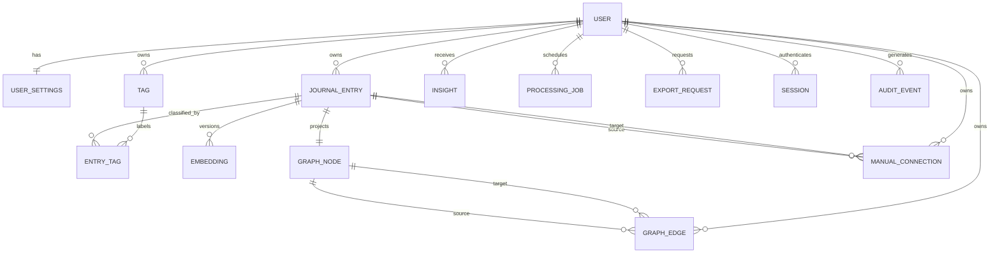

# Conceptual Data Model

## 1. Modeling principles

The relational model makes user ownership explicit on every sensitive aggregate. Source entries remain authoritative; embeddings, graph structures, and insights are derived and rebuildable. No SQL or migrations are specified in Phase 0.

Use UUIDs or another non-sequential opaque identifier for externally exposed resources. Store timestamps in UTC and render in the user's preferred timezone. MVP deletion is explicit and permanent: remove source content from live reads immediately and do not provide recovery or undo. A short-lived internal deletion marker may support idempotent cleanup, but it is not recoverable user data.

## 2. Entities

### User

**Purpose:** Account identity and authentication root.  
**Important fields:** opaque ID, normalized email, password hash, status, created/updated timestamps, deletion state.  
**Relationships:** owns entries, tags, connections, settings, jobs, exports, and insights.  
**Constraints:** unique normalized email; no plaintext credentials; status controls access.  
**Deletion:** revoke sessions immediately, then cascade/queue deletion of owned and derived data.

### UserSettings

**Purpose:** Preferences and consent/configuration.  
**Fields:** user ID, timezone, locale, theme, reduced-motion preference, graph defaults, consent/version timestamps.  
**Constraints:** one row per user; settings cannot grant access to another user.  
**Deletion:** delete with user; retain only legally necessary consent/audit metadata.

### JournalEntry

**Purpose:** Original user-authored title/body and temporal metadata.  
**Fields:** ID, user ID, title, body, entry date, created/updated timestamps, revision, processing status, deleted timestamp.  
**Relationships:** has tags, embedding revisions, graph node, manual connections, and generated edges.  
**Constraints:** owner required; bounded text; revision increments atomically; date valid.  
**Deletion:** an explicit permanent-delete request removes the entry from live reads and initiates idempotent cleanup of all dependent data. No MVP trash, restore, or undo state exists.

### Tag

**Purpose:** User-defined classification.  
**Fields:** ID, user ID, normalized name, display name, timestamps.  
**Constraints:** unique normalized name per user; bounded length.  
**Deletion:** remove association rows; optionally retain tag only while referenced.

### EntryTag

**Purpose:** Many-to-many entry/tag association.  
**Fields:** entry ID, tag ID, created timestamp.  
**Constraints:** composite uniqueness; entry and tag must share the same user through constraints/application checks.  
**Deletion:** cascade with entry or tag.

### Embedding

**Purpose:** Versioned vector representation of an entry revision.  
**Fields:** ID, user ID, entry ID, source revision, model name/version, dimensions, vector, status, error class, timestamps.  
**Constraints:** unique entry/revision/model combination; vector dimensions match model; owner matches entry.  
**Deletion:** remove when source revision/account is deleted; stale rows may be retained briefly only if policy requires.

### GraphNode

**Purpose:** Stable graph identity for an entry across embedding, model, and graph-policy changes.  
**Fields:** ID, user ID, entry ID, visibility/status, layout metadata if persisted, timestamps.  
**Constraints:** exactly one graph node identity per active entry/user; owner matches entry. `GraphNode` does not carry an embedding model or graph-policy version. Those versions belong to the derived graph projection and its edges.  
**Deletion:** remove with the entry during permanent deletion; it is not recreated merely because a model or graph policy changes.

### GraphEdge

**Purpose:** Derived semantic relationship between two entries.  
**Fields:** ID, user ID, `source_node_id`, `target_node_id`, similarity score, method, model version, threshold/policy version, status, timestamps.  
**Relationships:** `source_node_id` and `target_node_id` each reference `GraphNode`; the application treats the pair as undirected for constellation display, while source/target provide deterministic storage and traversal direction.  
**Constraints:** endpoints share owner; no self-edge; source and target are canonicalized so the lower opaque identifier is stored as source; one active edge exists per canonical node pair, model version, and policy version; score is in the valid cosine range; deleted/stale nodes cannot have current edges.  
**Deletion:** recompute/deactivate when either embedding changes; remove with account.

### ManualConnection

**Purpose:** Explicit relationship chosen by the user.  
**Fields:** ID, user ID, `source_entry_id`, `target_entry_id`, optional label/note, timestamps.  
**Relationships:** both entry references point to `JournalEntry`; the connection is undirected in the user experience, with canonical source/target ordering for storage.  
**Constraints:** same owner; no self-link; one manual connection per canonical entry pair per user; both entries must be active for a current connection; a manual connection may coexist with a `GraphEdge` for the same pair because they are independent relationship types; semantic recomputation cannot update or delete it.  
**Deletion:** remove with either entry or account; never overwrite through semantic recomputation.

### Insight

**Purpose:** Versioned, descriptive aggregate derived from a user's archive.  
**Fields:** ID, user ID, type, text/structured payload, date range, source entry IDs or references, method/version, status, generated timestamp.  
**Constraints:** owner required; minimum evidence policy; payload excludes unsupported psychological conclusions.  
**Deletion:** remove/rebuild with source data; never expose cross-user aggregate data.

### ProcessingJob

**Purpose:** Idempotent asynchronous work tracking.  
**Fields:** ID, user ID, resource ID/type, job kind, source revision/model version, status, attempts, lease/retry timestamps, safe error class.  
**Constraints:** unique idempotency key; bounded attempts; owner scope immutable.  
**Deletion:** cancel/remove with account; no body content in payload.

### ExportRequest

**Purpose:** Track scoped data export.  
**Fields:** ID, user ID, status, requested/completed/expiry timestamps, storage key, download count.  
**Constraints:** storage key is private and time-limited; no content in ordinary database logs.  
**Deletion:** expire and securely remove artifact according to policy.

### Session / AuditEvent

**Purpose:** Session revocation and security accountability.  
**Fields:** hashed session token, user ID, expiry/revocation; audit actor/action/resource type/request ID/timestamp.  
**Constraints:** never store raw tokens or journal content.  
**Deletion:** revoke with account; retain minimal security events for documented duration.

## 3. Indexing and integrity

- Unique normalized email on User.
- Composite owner/time indexes for entry archive and timeline queries.
- Owner-scoped tag and EntryTag indexes.
- Full-text index over title/body with owner filtering.
- pgvector index chosen after measuring dataset and query distribution; always combine with owner/model compatibility filtering.
- Owner and endpoint indexes for nodes, edges, and manual connections.
- Job indexes on status, retry time, and idempotency key.
- Foreign keys with intentional cascade/restrict behavior; application checks for same-owner relationships.
- Avoid exposing internal database error details when constraints reject malformed relationships.

## 4. Ownership invariant

Every read path begins with the authenticated user scope. A relationship is valid only when all referenced sensitive records belong to that same user. Background jobs, exports, insights, and caches carry the owner scope and re-check it at execution/read time. This invariant must be enforced in code, tested across users, and preferably reinforced with database row-level security.

## 5. Mermaid ER diagram

## 6. Derived-data lifecycle

Source entry save is transactional. Each active entry has one stable `GraphNode`; embeddings and graph projections are asynchronous and versioned. A graph projection consists of a model version, graph-policy version, and its active `GraphEdge` set. A stale edge/projection may exist briefly, but APIs must expose its status and never treat it as current without checking source revision, model version, and policy version. Model upgrades create a new edge projection over the same stable nodes, then atomically make it current; nodes are not duplicated. Rebuilds must be deterministic enough to compare results and safe to retry.
